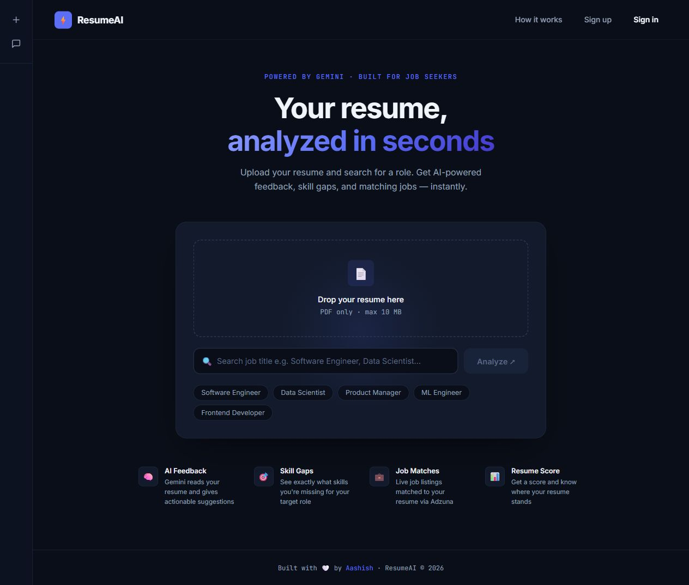
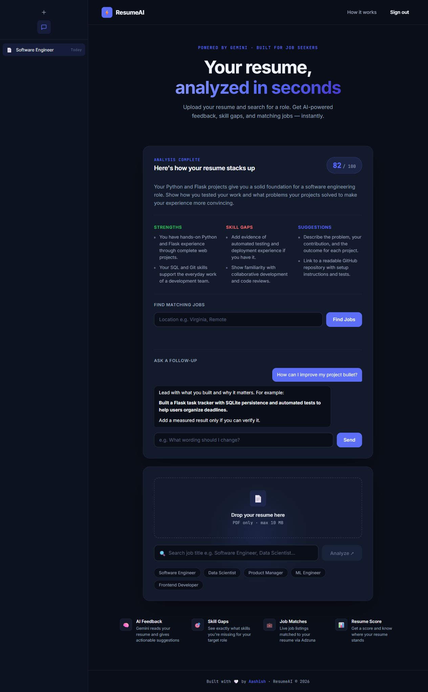
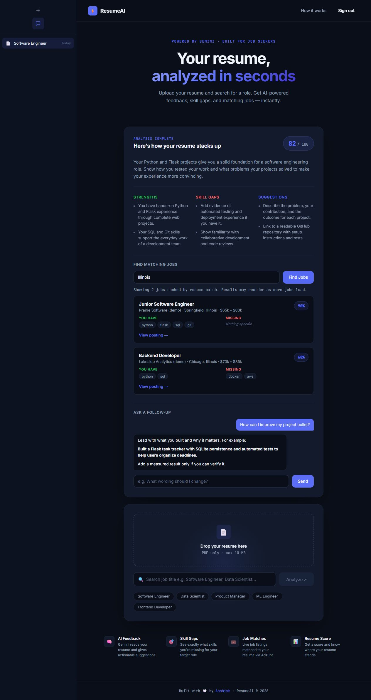
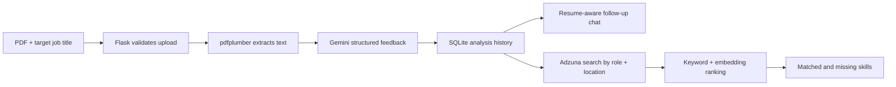

# IntelliResume

**A resume analysis and job discovery web app built with Flask, Gemini, and Adzuna.**

IntelliResume helps job seekers understand how their resume fits a target role, ask follow-up questions, and find relevant job listings by location. The interface retains its original **ResumeAI** branding.



## Features

- **PDF resume analysis:** Extract text with pdfplumber and request structured feedback from Gemini: a score, summary, strengths, skill gaps, and suggestions.
- **Follow-up conversations:** Ask questions with the resume, target role, and saved conversation as context.
- **Location-based job discovery:** Search US job listings through Adzuna, with paginated results.
- **Explainable job matching:** Show matched and missing technical skills. Combine keyword overlap with local embedding similarity; fall back to keyword ranking if embeddings are unavailable.
- **Accounts and history:** Use password hashing and session authentication to keep each user's analyses and conversations associated with their account.
- **Input and rendering safeguards:** Validate uploaded PDFs and credential inputs, sanitize rendered chat Markdown, and ignore outdated responses when the active analysis changes.





Screenshots use fictional resume, feedback, conversation, and job data for demonstration. Actual feedback and job listings depend on the providers.

## How it works



The backend uses a Pydantic schema for Gemini's analysis response. Chat requests include the resume and prior messages. Job ranking blends **60% keyword overlap** with **40% calibrated embedding similarity**, using `all-MiniLM-L6-v2`. If model loading or inference fails, the whole batch uses keyword scores. These scores are heuristics, not hiring predictions.

## Technology

| Area | Tools |
| --- | --- |
| Backend | Python, Flask |
| Resume extraction | pdfplumber |
| AI feedback and chat | Google Gen AI SDK, Gemini, Pydantic |
| Job search and ranking | Adzuna API, Sentence Transformers, NumPy |
| Persistence and authentication | SQLite, SQLAlchemy, Flask-Migrate, Flask-Login, Flask-Bcrypt |
| Frontend | HTML, CSS, JavaScript, marked, DOMPurify |
| Testing | Python unittest, Node.js test runner |

## Run locally

Use **Python 3.14**. Node.js **22 or newer** is needed only for the JavaScript regression tests. You need your own Gemini API key and Adzuna app ID/API key for live provider requests.

```sh
git clone https://github.com/aashish15g/IntelliResume.git
cd IntelliResume
python -m venv .venv
```

Activate the environment:

```powershell
# Windows PowerShell
.venv\Scripts\Activate.ps1
```

```sh
# macOS / Linux
source .venv/bin/activate
```

Install dependencies and create your local configuration:

```sh
python -m pip install -r requirements.txt
```

```powershell
# Windows PowerShell
Copy-Item .env.example .env
```

```sh
# macOS / Linux
cp .env.example .env
```

Edit `.env` locally with your provider credentials. Generate a random Flask session secret with:

```sh
python -c "import secrets; print(secrets.token_hex(32))"
```

Initialize a fresh database and start the local development server:

```sh
python -m flask --app run:flask_app db upgrade
python -m flask --app run:flask_app run
```

Open **http://127.0.0.1:5000**. Create an account, sign in, upload a text-based PDF, and enter a target job title. API calls may incur provider costs or be subject to quotas.

The first job-ranking request may download the embedding model. It is cached locally for subsequent runs. If loading fails, job search remains available through keyword ranking. SQLite data is created locally under `instance/`; no populated database is distributed.

## Project structure

```text
IntelliResume/
├── app.py                  # Flask application factory and extensions
├── run.py                  # Local application entry point
├── routes.py               # Authentication, analyses, chat, and job endpoints
├── models.py               # User, analysis, and conversation records
├── decorators.py           # Retry and timing helpers
├── services/               # PDF parsing, Gemini requests, job ranking, skill aliases
├── templates/index.html    # Application interface
├── static/                 # CSS, JavaScript, and bundled DOMPurify + its license
├── migrations/             # Database schema migrations
├── tests/                  # Backend and frontend regression tests
├── docs/images/            # Screenshots using fictional data
├── .githooks/pre-push      # Optional local secret-scanning guard
├── .github/workflows/      # Automated regression checks
├── .env.example            # Safe configuration placeholders
└── requirements.txt        # Python dependencies
```

## Tests

```sh
python -m unittest discover -s tests -v
node --test tests/frontend.test.cjs
```

The 22 regression tests cover credential validation, duplicate registration, skill aliases and boundaries, lazy model loading, keyword fallback, stale responses, cancelled animations, and duplicate analysis submissions. Tests use in-memory databases and mocked provider calls, so real credentials and paid API calls are unnecessary.

GitHub Actions runs both suites, checks the committed files for private-file names, and validates migration from an empty database.

## Keep secrets local

- `.env` variants, private keys, local databases, uploads, PDFs, and logs are excluded from new commits. `.env.example` contains placeholders only.
- Do not hardcode credentials in source code, paste them into issues, or include them in screenshots.
- An old timing log remains in development history. The full history was scanned before publication; the current log remains local and ignored.
- Install [Gitleaks](https://github.com/gitleaks/gitleaks) and enable the supplied local guard:

```sh
git config core.hooksPath .githooks
```

The pre-push hook checks the committed file names and scans complete history with redacted output. It blocks the push if Gitleaks is missing or reports a finding. Hooks need to be enabled separately in each clone. GitHub push protection is an additional safeguard; neither ignore rules nor scanners replace reviewing what you commit.

## Limitations

- Text-based PDF resumes only, up to 10 MB. Scanned pages need OCR before upload.
- Role feedback is based on a job title, rather than a specific employer's full job description. AI output may be inaccurate.
- The chat uses the resume and message history; the initial analysis feedback is not included in the chat context.
- Job discovery currently targets the US. Job descriptions may be abbreviated, and keyword matching focuses on technical skills.
- This is a portfolio project and local development application. Production hosting would need a production server and additional authentication, abuse prevention, and privacy controls.

## Author

Built by **Aashish Ganeshkumar**, a B.S. Computer Science student at the **University of Illinois Springfield**.

The repository is public for portfolio review. No project-wide open-source license has been granted. The bundled DOMPurify license is retained in `static/javascript/vendor/DOMPurify-LICENSE.txt`.
